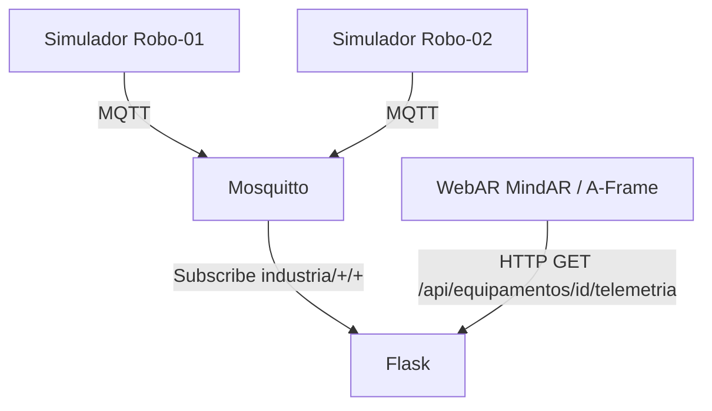

# Arquitetura

As leituras são simuladas. O frontend utiliza a imagem target para identificar o robô, mostra hotspots técnicos estáticos e consulta o Flask apenas no hotspot de monitoramento. O backend guarda os valores mais recentes em memória; reiniciar o processo descarta as últimas leituras até chegarem novas mensagens.
